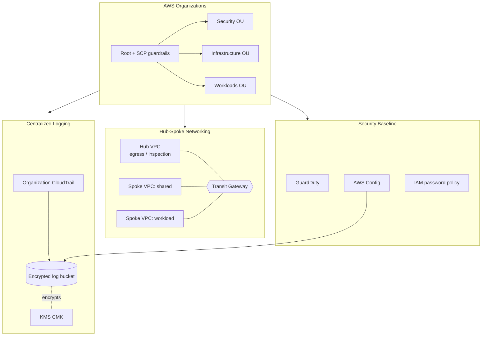

# Terraform AWS Landing Zone

[](LICENSE)
[](https://github.com/abhisheksawant52/terraform-aws-landing-zone/actions/workflows/ci.yml)
[](https://www.terraform.io/)
[](https://registry.terraform.io/providers/hashicorp/aws/latest)

A modular, multi-account **AWS landing zone** built with Terraform. It codifies
the account structure, guardrails, networking, and security baseline a new AWS
organization needs before any workload is deployed.

## Overview

Standing up AWS at enterprise scale means solving the same foundational problems
every time: how accounts are organized, which guardrails apply everywhere, how
VPCs connect, and how audit logs are collected centrally. This project captures
that foundation as reusable Terraform.

It is aimed at platform and cloud engineering teams bootstrapping a new AWS
Organizations footprint, or hardening an existing one. The layout follows a
hub-and-spoke network topology with a centralized security and log-archive
tier, and preventive Service Control Policies applied at the organization root.

The root module composes four submodules — `organization`, `networking`,
`security`, and `logging` — and is parameterized per environment (`dev`,
`prod`) via tfvars and partial backend configs.

## Architecture



Components:

- **organization** — AWS Organizations, Organizational Units, member accounts,
  and baseline Service Control Policies (deny leaving the org, deny disabling
  security services, deny root actions).
- **networking** — Transit Gateway with a hub VPC and per-spoke VPC
  attachments; default routes send spoke egress through the hub.
- **security** — GuardDuty detector, AWS Config recorder + delivery channel,
  and a strict IAM account password policy.
- **logging** — organization-wide, multi-region CloudTrail delivering to a
  versioned, KMS-encrypted S3 bucket with lifecycle expiration.

## Features

- Multi-account structure driven entirely by a typed `accounts` map.
- Preventive guardrails via Service Control Policies at the org root.
- Hub-and-spoke connectivity with AWS Transit Gateway.
- Centralized, encrypted, tamper-evident audit logging (log file validation).
- Threat detection (GuardDuty) and continuous compliance (AWS Config).
- Consistent tagging through provider `default_tags`.
- Environment isolation with per-environment tfvars and remote state backends.

## Tech Stack

Terraform >= 1.5 · AWS Provider ~> 5.0 · AWS Organizations · Transit Gateway ·
CloudTrail · AWS Config · GuardDuty · KMS · S3 · GitHub Actions · TFLint

## Getting Started

### Prerequisites

- Terraform >= 1.5
- AWS credentials for the **management (payer) account** with Organizations
  permissions
- An S3 bucket + DynamoDB table for remote state (see `environments/*/backend.hcl`)

### Configure

```bash
cp terraform.tfvars.example terraform.tfvars
# edit accounts, CIDRs and region to match your organization
```

### Initialize & plan

```bash
# Initialize with the environment backend (partial config)
terraform init -backend-config=environments/dev/backend.hcl

# Format, validate and plan
make fmt-check
make validate
make plan ENV=dev
```

> Note: applying this module operates on your AWS **Organizations** root and
> creates accounts. Review the plan carefully; this repository does not run
> `terraform apply` in CI.

## Project Structure

```
.
├── main.tf                      # composes the four submodules
├── variables.tf                 # root input variables
├── outputs.tf                   # organization/network/logging outputs
├── versions.tf                  # required_providers + backend (commented)
├── providers.tf                 # AWS provider + default tags
├── terraform.tfvars.example     # sample configuration
├── modules/
│   ├── organization/            # Organizations, OUs, accounts, SCPs
│   ├── networking/              # Transit Gateway + hub/spoke VPCs
│   ├── security/                # GuardDuty, Config, IAM baseline
│   └── logging/                 # CloudTrail + KMS-encrypted S3 archive
├── environments/
│   ├── dev/{terraform.tfvars,backend.hcl}
│   └── prod/{terraform.tfvars,backend.hcl}
└── .github/workflows/ci.yml     # fmt / validate / tflint
```

## Configuration

| Variable             | Default              | Description                               |
| -------------------- | -------------------- | ----------------------------------------- |
| `aws_region`         | `eu-west-1`          | Primary region for the landing zone.      |
| `environment`        | `dev`                | Environment name (drives tags & naming).  |
| `organization_units` | `[Security, ...]`    | Top-level OUs to create under the root.   |
| `accounts`           | `{}`                 | Member accounts keyed by alias.           |
| `enable_scp`         | `true`               | Attach baseline Service Control Policies. |
| `hub_vpc_cidr`       | `10.0.0.0/16`        | CIDR for the hub VPC.                      |
| `spoke_vpc_cidrs`    | `{shared, workload}` | CIDR per spoke VPC.                        |
| `log_retention_days` | `365`                | Log archive retention.                    |
| `enable_guardduty`   | `true`               | Enable GuardDuty.                         |
| `enable_config`      | `true`               | Enable AWS Config.                        |

## Deployment

Each environment has its own state backend and variables:

```bash
terraform init -backend-config=environments/prod/backend.hcl
terraform plan -var-file=environments/prod/terraform.tfvars
```

Wire `terraform plan` into a change-review pipeline; promote from `dev` to
`prod` by switching the backend and var-file only.

## Contributing

Contributions are welcome — see [CONTRIBUTING.md](CONTRIBUTING.md) and our
[Code of Conduct](CODE_OF_CONDUCT.md).

## Security

Please report vulnerabilities as described in [SECURITY.md](SECURITY.md).

## License

Released under the [MIT License](LICENSE).
